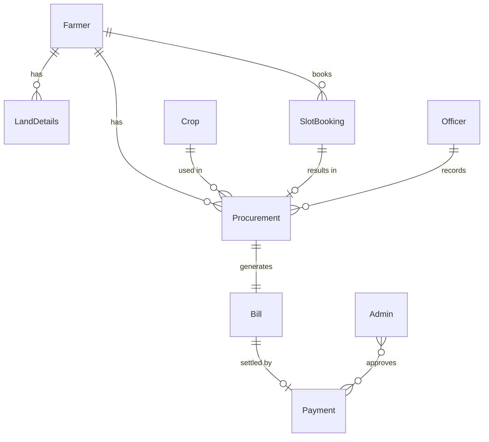

# ER Diagram
## Paddy Procurement System

Entities and relationships (implemented in SQLite schema).

---

### Entities

| Entity       | Key Attributes |
|-------------|----------------|
| **Farmer**  | id, name, aadhaar, phone, email, password_hash, created_at |
| **LandDetails** | id, farmer_id (FK), survey_no, village, area_acres, created_at |
| **Crop**    | id, name, msp_per_kg, season, created_at |
| **SlotBooking** | id, farmer_id (FK), slot_date, slot_time, status, created_at |
| **Procurement** | id, farmer_id (FK), slot_booking_id (FK), crop_id (FK), weight_kg, moisture_pct, msp_rate, amount, officer_id (FK), created_at |
| **Bill**    | id, procurement_id (FK), bill_no, total_amount, status, created_at |
| **Payment** | id, bill_id (FK), amount, mode, reference_no, approved_by (FK), paid_at |
| **Admin**   | id, name, email, password_hash, created_at |
| **Officer** | id, name, email, password_hash, created_at |

### Relationships

- **Farmer** 1 —— N **LandDetails**
- **Farmer** 1 —— N **SlotBooking**
- **Farmer** 1 —— N **Procurement**
- **Crop** 1 —— N **Procurement**
- **SlotBooking** 1 —— 1 **Procurement** (one booking can result in one procurement)
- **Procurement** 1 —— 1 **Bill**
- **Bill** 1 —— 1 **Payment** (one payment per bill when paid)
- **Officer** 1 —— N **Procurement** (officer who recorded)
- **Admin/Officer** can approve **Payment**

### Mermaid ER (conceptual)

